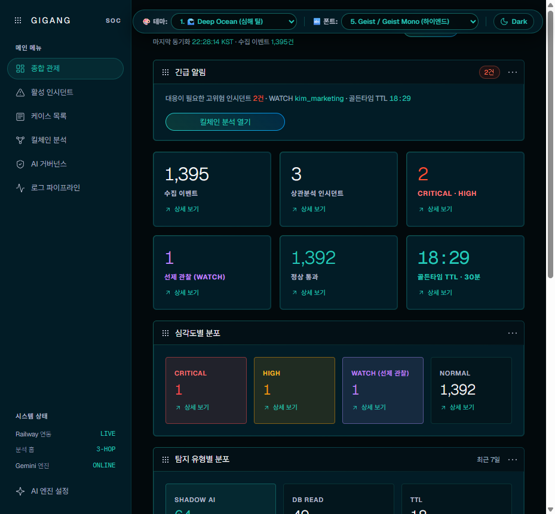
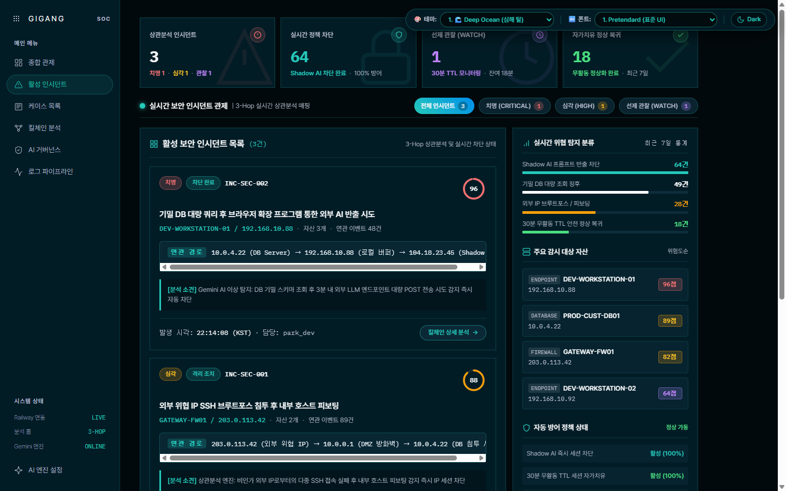
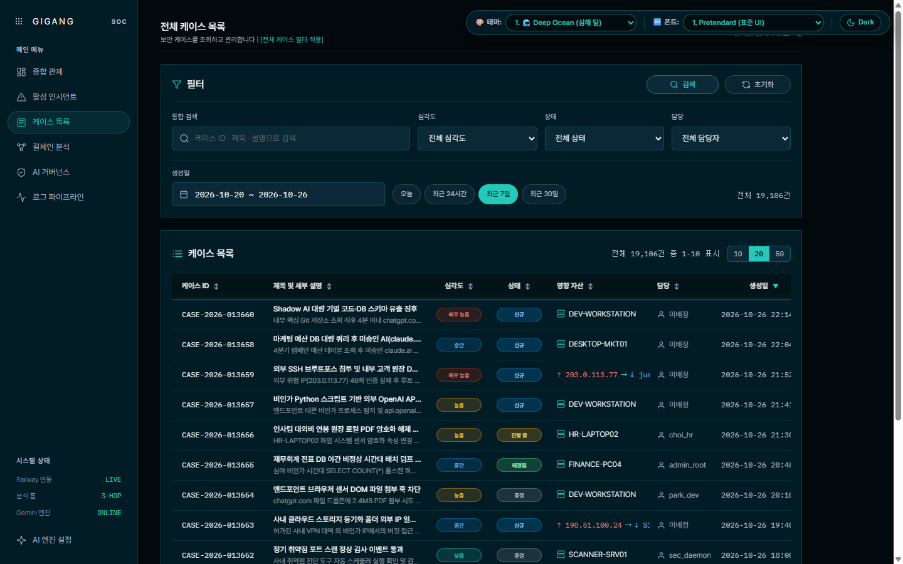
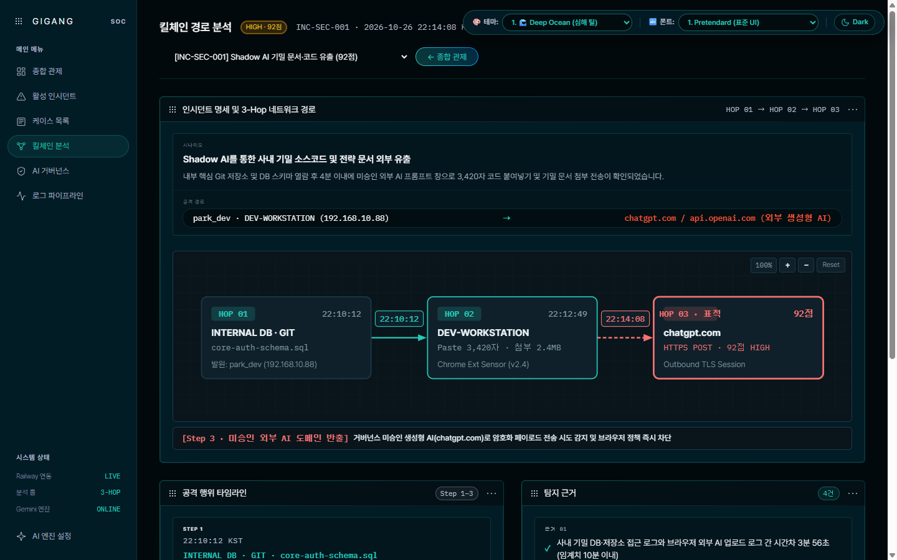
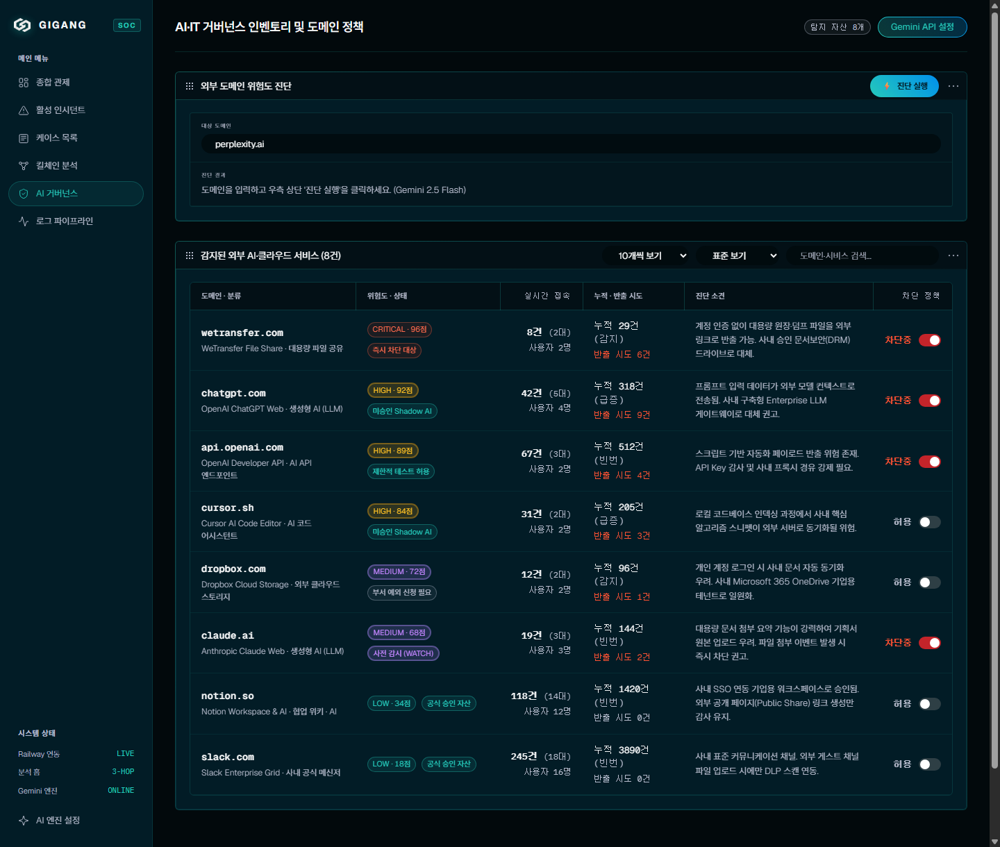
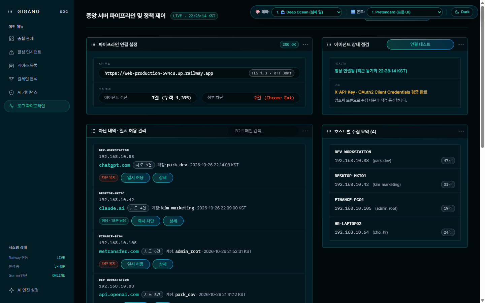
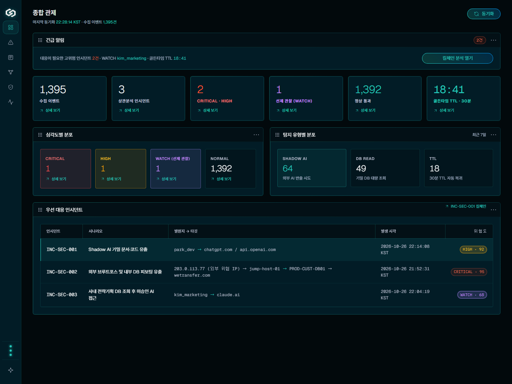
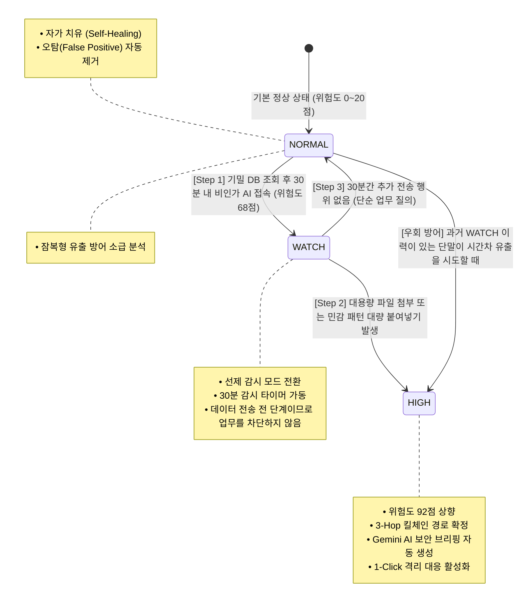
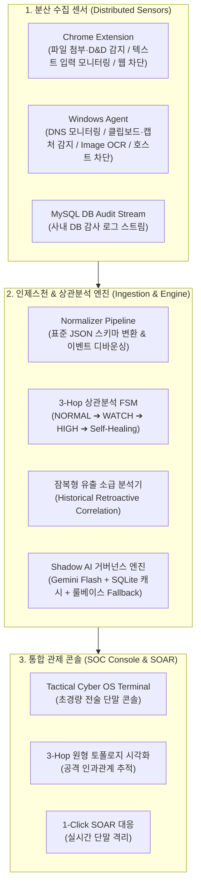

# GIGANG (Zero Trust SecOps Platform)
### 엔드포인트-DB-웹 다기종 로그 상관분석 & 섀도우 AI 거버넌스 플랫폼 (v4.0 Enterprise Edition)


> **"업무는 자유롭게, 기밀은 안전하게"**  
> 데이터가 유출된 뒤에야 알리는 사후 대응이나, 업무를 무조건 틀어막는 일률적 차단은 실효성이 떨어집니다.  
> GIGANG은 사내 기밀 DB 접근부터 사용자 단말 행위(클립보드, 화면 캡처, OCR, 파일 조작), 브라우저 기반 외부 미승인 AI/SaaS 전송까지 3차원 인과관계를 분석합니다. **선제 감시(WATCH) ➔ 실제 유출 포착 시 즉시 격리(HIGH) ➔ 정상 업무 시 30분 내 원복(Self-Healing)** 메커니즘으로 사내 자산을 지키는 차세대 보안 관제 플랫폼입니다.

---

## 🛡️ 차세대 사이버 OS 관제 단말기 (Next-Gen Cyber OS Terminal)

GIGANG v4.0부터 고밀도 보안 관제 환경에 맞춘 **전술 사이버 OS 콘솔(Tactical Cyber OS Terminal)**이 메인 인터페이스로 기본 탑재되었습니다. 



### 인터페이스 특징
- **표준 테크니컬 디자인 단일화**:
  - **테마**: Deep Ocean Cyan (심해 흑청 베이스 & 일렉트릭 시안 포인트)
  - **타이포그래피**: Geist / Geist Mono (고밀도 테크니컬 가독성 확보)
- **0ms 즉각 반응성 & 플리커링 제로**:
  - 버튼 클릭 시 발생하는 불필요한 투명도 전환(`stageFadeUp`)과 단계별 딜레이를 완전히 걷어내 깜빡임 없는 조작감을 제공합니다.
  - 작업 흐름을 방해하던 비동기 토스트 알림 팝업을 전면 차단해 관제 업무 집중도를 높였습니다.
- **순수 풀스크린 몰입형 레이아웃**:
  - 중복되던 레거시 사이드바와 토글 패널을 화면에서 제거하고, 화면 전체를 100% 활용하는 전술 독(Dock) 기반 단일 메뉴로 통합했습니다.
- **6개 핵심 관제 뷰**:
  1. **종합 관제 (Overview)**: 6대 전술 KPI 지표, 주요 경보 및 실시간 위협 요약
  2. **활성 인시던트 (Active Incidents)**: 4대 KPI 요약과 11개 상관분석 인시던트 카드
  3. **전체 케이스 목록 (Case Management)**: 실시간 열 정렬과 필터를 지원하는 포렌식 테이블
  4. **3-Hop 공격 킬체인 분석 (Kill Chain)**: DB ➔ 단말 ➔ 외부 AI 경로 추적 및 타임라인 토폴로지
  5. **Shadow AI 거버넌스 (Governance)**: 도메인 차단·승인 제어와 Gemini AI 위험 진단
  6. **멀티소스 로그 파이프라인 (Pipeline)**: 인증·방화벽·단말·DB 실시간 텔레메트리 수집 스트림
- **인체공학적 조작성**:
  - 원클릭 독 접기/펼치기 (`Ctrl+B`)
  - WCAG 2.1 AA 기준을 충족하는 4.5:1 이상의 텍스트 명도 대비 적용

### 관제 화면 구성
| 1. 종합 관제 (Overview) | 2. 활성 인시던트 (Active Incidents) |
|---|---|
|  |  |

| 3. 전체 케이스 목록 (Cases) | 4. 3-Hop 킬체인 분석 (Kill Chain) |
|---|---|
|  |  |

| 5. Shadow AI 거버넌스 (Governance) | 6. 멀티소스 로그 파이프라인 (Pipeline) |
|---|---|
|  |  |

| 7. 사이드바 축소 모드 (Collapsed Rail Mode) |
|---|
|  |

### 단말기 실행 방식
- **웹 대시보드 실행**: `streamlit run app.py` (또는 `run-dashboard.bat`) 실행 시 브라우저에서 사이버 OS 관제 콘솔이 바로 열립니다.
- **독립 실행 (Zero-Dependency)**: 루트의 `GIGANG_Data_Terminal_Beta.html` 또는 `run_beta_terminal.bat`을 더블 클릭해 브라우저 단독 화면으로 띄울 수 있습니다.

---

## ⚡ 핵심 기능 및 운영 메커니즘

### 1. 3단계 동적 라이프사이클 (FSM Risk Engine)
불필요한 오탐 알람을 걸러내고 유출 사고 대응 골든타임을 확보하는 유한 상태 머신(FSM) 기반 상관분석 엔진입니다.



- **선제 감시 (WATCH)**: 기밀 DB를 조회한 사용자가 30분 안에 외부 AI 사이트에 접속하면 위험도를 68점으로 올리고 30분 타이머를 가동합니다.
- **침해 확정 및 차단 (HIGH)**: 감시 상태에서 대용량 파일 첨부나 민감 정보 붙여넣기가 발생하면 위험도를 92점으로 올리고 3-Hop 공격 경로를 연결해 격리 대응을 준비합니다.
- **자가 치유 (Self-Healing)**: 30분 동안 추가 유출 정황이 없으면 상태를 NORMAL로 되돌려 관제 피로를 줄입니다.

### 2. 본문 미수집 원칙 (Zero Payload Ingestion)
- 사용자 단말 브라우저나 클립보드에서 텍스트 본문과 원본 파일을 수집하지 않습니다.
- 텍스트 길이, 파일 바이트 수, 민감 패턴(주민번호, 계좌번호 등) 일치 건수, 타임스탬프, 도메인 정보만 파싱하여 개인정보 침해 우려 없이 분석합니다.

### 3. Image Guard & OCR 시각 유출 방어
- 캡처 이미지나 클립보드 그래픽 데이터를 외부 AI 서비스로 드래그할 때, 단말 에이전트 내장 OCR로 민감 텍스트 패턴 수만 집계해 이미지 기반 우회 유출을 감지합니다.

### 4. 맥락 기반 Shadow AI 거버넌스 & Gemini AI Copilot
- 단순 도메인 주소뿐 아니라 사내 누적 트래픽과 사용자 빈도를 결합해 AI 프롬프트에 전달하고 실시간 위험도를 평가합니다.
- 진단 결과는 SQLite 로컬 캐시에 저장해 반복 조회 비용을 아끼며, API 키가 없거나 네트워크가 끊겨도 내장 룰베이스 엔진으로 끊김 없이 판정합니다.
- 최종 차단 및 격리는 관제 요원의 1-Click 승인을 거치도록 설계했습니다.

### 5. 부서별 맞춤 정책
- 고객지원(CS), 인사(HR), 재무(FIN), 개발(DEV) 등 부서별 고유 업무에 맞춰 정상 업무는 로그만 남기고, 권한 밖의 이상 행위는 WATCH 상태로 올립니다.

### 6. 능동 방어 (Active Defense)
- 관리자가 콘솔에서 차단을 승인하면 단말 에이전트(hosts 기반 통신 제한)와 Chrome 확장 프로그램(차단 안내 화면 전환)에 정책이 동시에 적용되어 유출을 막습니다.

---

## 🏗️ 시스템 구조 (3-Tier Architecture)



---

## 📁 디렉터리 구조

```text
GIGANG/
├── app.py                             # 대시보드 진입점 (Cyber OS 자동 마운트)
├── run-dashboard.bat                  # 관제 대시보드 실행 스크립트
├── run_beta_terminal.bat              # Cyber OS 관제 터미널 단독 실행 스크립트
├── ADMIN_START.bat / ADMIN_STOP.bat   # 관리자 프로세스 실행 및 종료 스크립트
├── USER_START.bat / USER_STOP.bat     # 사용자 단말 에이전트 실행 및 종료 스크립트
├── RUN_ALL_TESTS.bat                  # 전체 단위 테스트 일괄 실행 스크립트
├── GIGANG_Data_Terminal_Beta.html     # 독립 실행형 전술 관제 터미널
├── VERSION.txt                        # 버전 정보
├── requirements.txt                   # 파이썬 의존성 목록
├── run_demo.py                        # 시뮬레이션 검증 스크립트
├── compare_engines.py                 # FSM 엔진 성능 비교
│
├── guard/                             # 단말 센서 및 수집 서브시스템
│   ├── agent/                         # Windows 단말 에이전트 (OCR, 클립보드, hosts 제어)
│   └── browser_extension/             # Chrome 확장 프로그램 (웹 패킷 감시 및 차단)
│
├── gigang/                            # 백엔드 및 관제 패키지
│   ├── collectors/                    # 로그 수집 및 Railway 연동 모듈
│   ├── engine/                        # 3단계 FSM 상관분석 및 AI 거버넌스 엔진
│   ├── generators/                    # 시뮬레이션 로그 생성기
│   ├── schemas/                       # 표준 이벤트 스키마
│   ├── storage/                       # 인메모리 스토어 및 SQLite 캐시
│   └── ui/                            # Streamlit 대시보드 UI
│
├── source/railway_server/             # 중앙 인제스천 클라우드 서버 (FastAPI)
│   ├── Dockerfile
│   ├── app.py
│   ├── policy_tables.sql
│   └── site_access.py
│
├── tools/                             # 런타임 제어 유틸리티
│   ├── launch.py                      # 프로세스 실행기
│   ├── stop.py                        # 프로세스 정리 및 격리 해제
│   └── lifecycle.py                   # 서비스 수명주기 관리
│
├── prototypes/                        # 관제 터미널 프로토타입
│   ├── gigang_data_terminal.html      # 전술 사이버 OS 터미널 뷰
│   └── gigang_5themes_prototype.html  # 테마 프로토타입
│
├── data/
│   ├── activity.log                   # 텔레메트리 활동 로그
│   └── mysql_audit_log.csv            # DB 샘플 감사 로그
│
└── docs/
    ├── GIGANG_DB_Test_Guide.md                 # DB 감사 연동 가이드
    ├── GIGANG_Operational_Mechanism_Analysis.md # FSM 아키텍처 상세 보고서
    ├── GIGANG_Emergency_Meeting_Feedback.md    # 기술 검토 피드백
    ├── GIGANG_Improvement_Specification_v2.md  # 관제 개선 기획서
    └── screenshots/                            # 대시보드 화면 증적 (01~07)
```

---

## 🚀 빠른 시작 가이드

### 1. 환경 준비
- **Python 3.10 이상**
- Google Chrome 브라우저
- Google Gemini API Key (선택 사항: 키가 없어도 내장 룰베이스 엔진으로 자동 전환되어 정상 동작)

### 2. 저장소 클론 및 패키지 설치
```bash
git clone https://github.com/dldaudlee36/GIGANG.git
cd GIGANG

pip install -r requirements.txt
```

### 3. 환경 변수 설정 (선택 사항)
Gemini AI 진단 기능을 연동하려면 루트 경로의 `.env` 파일에 API 키를 입력합니다:
```bash
GEMINI_API_KEY=your_gemini_api_key_here
```

### 4. 실행 방법
- **대시보드 실행**: `run-dashboard.bat`을 실행하거나 아래 명령어를 입력합니다.
  ```bash
  python -m streamlit run app.py
  ```
  실행 후 브라우저(`http://localhost:8501`)로 접속하면 사이버 OS 단말기 화면이 바로 열립니다.
- **관리자/단말 프로세스 구동**:
  - 관리자 환경: `ADMIN_START.bat` (종료 시 `ADMIN_STOP.bat`)
  - 사용자 단말: `USER_START.bat` (종료 시 `USER_STOP.bat`)
  - 종료 스크립트를 실행하면 프로세스 정리와 함께 수정된 hosts 파일이 원래 상태로 복구됩니다.

### 5. Chrome 확장 프로그램 설치
1. Chrome 주소창에 `chrome://extensions`를 입력합니다.
2. 우측 상단의 **'개발자 모드'**를 켭니다.
3. **'압축해제된 확장 프로그램을 로드합니다'** 버튼을 누른 뒤 본 저장소의 `guard/browser_extension` 폴더를 선택합니다.

### 6. 단위 테스트 실행
```bash
# 전체 테스트 일괄 수행
RUN_ALL_TESTS.bat

# 주요 테스트 개별 수행
python run_demo.py
python test_dedup.py
python test_rules.py
python test_policy.py
```

---

## 👥 팀원 역할 분담 및 Git 브랜치 전략
GIGANG은 4대 핵심 도메인별 기능 브랜치로 나누어 협업합니다:

- **`feat/collector`**: Chrome Extension Web Sentry 센서, 파일 및 클립보드 텔레메트리 수집
- **`feat/normalizer`**: 이기종 다기종 로그 정규화(`common_schema.json`), 인제스천 파이프라인
- **`feat/engine`**: 3단계 동적 FSM 상관분석 엔진, 3-Hop 인과관계 추적, Gemini AI 거버넌스
- **`feat/ui`**: 차세대 사이버 OS 관제 콘솔, 3-Hop 킬체인 토폴로지 시각화, AI 거버넌스 대시보드

---
*GIGANG Security Operations Platform — "업무는 자유롭게, 기밀은 안전하게"*
