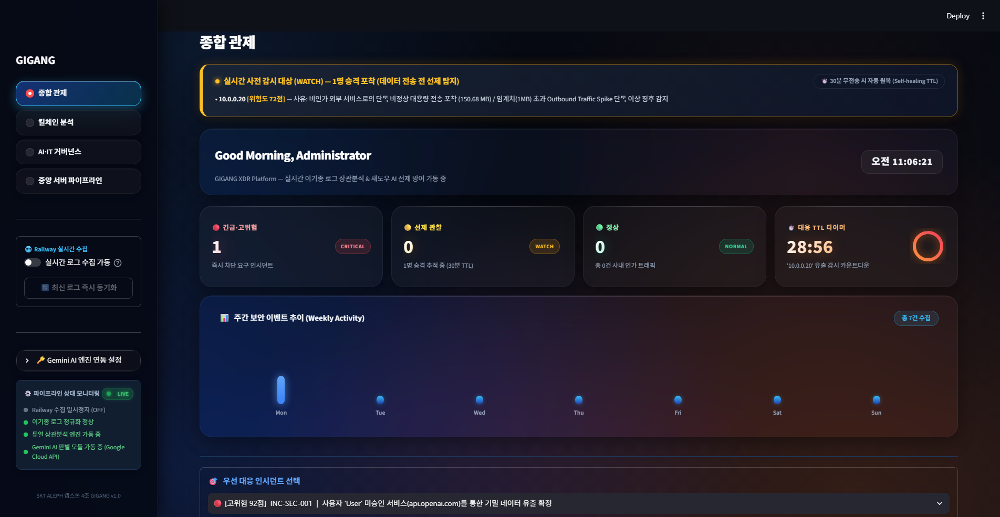
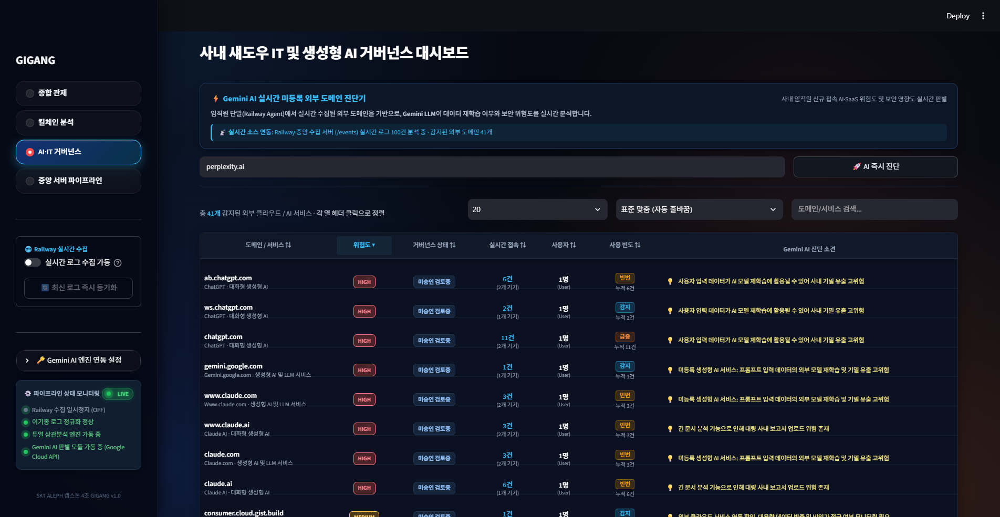
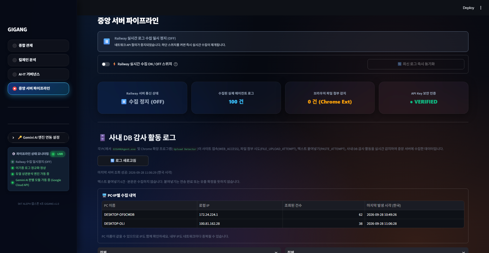
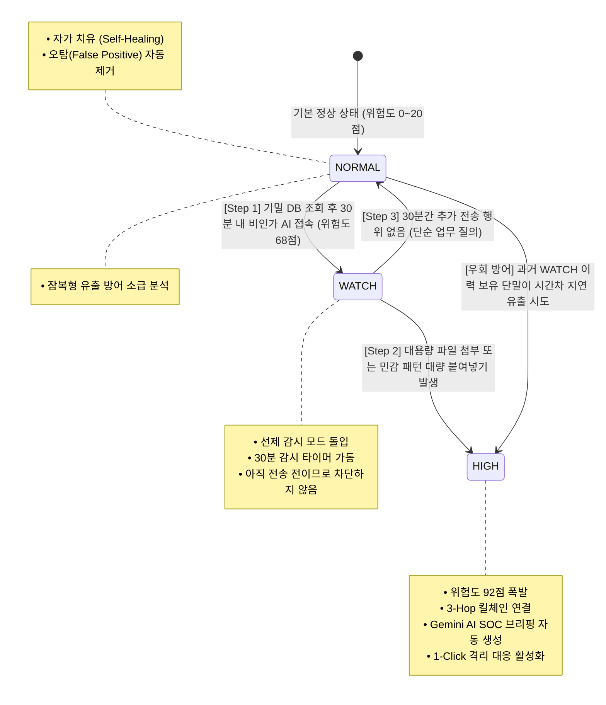
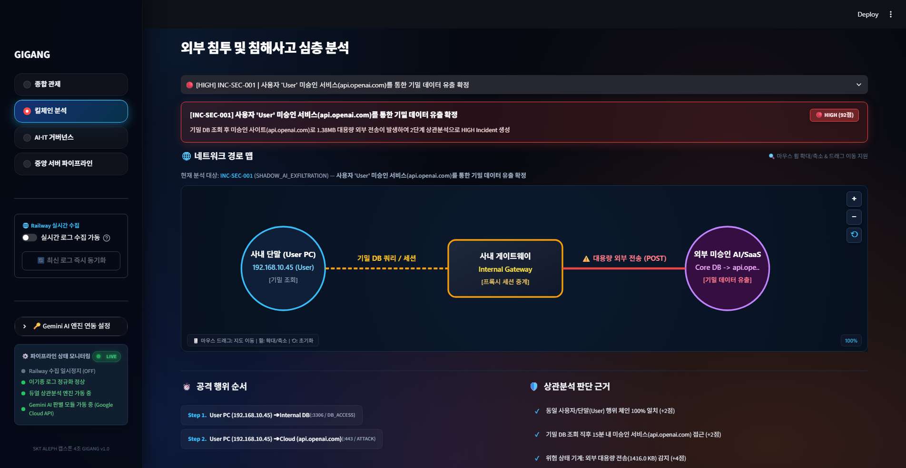
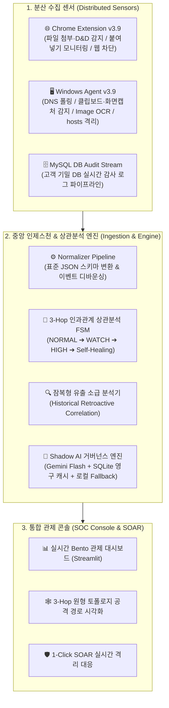

# 🛡️ GIGANG (Zero Trust SecOps Platform)
### Zero Trust 기반 엔드포인트-DB-웹 다기종 로그 상관분석 & 섀도우 AI 거버넌스 플랫폼 (v3.9 Integrated Edition)


> **"업무는 자유롭게, 기밀은 안전하게"**  
> 기존 SIEM처럼 데이터가 다 유출된 뒤에야 울리는 **'사후 약방문'**도, DLP처럼 모든 접근을 막아 업무를 마비시키는 **'무조건 차단'**도 아닙니다.  
> **GIGANG(기강)**은 사내 기밀 DB 접근부터 단말기 행위(클립보드, 화면 캡처/OCR, 파일 복사), 웹 브라우저를 통한 외부 미승인 AI/SaaS 유출까지 **3차원 인과관계 상관분석**을 수행하여, **'선제 감시(WATCH) ➔ 실제 유출 시 즉시 대응(HIGH) ➔ 정상 업무 시 스스로 정상화(30분 자가 치유)'**하는 차세대 지능형 보안관제(SecOps) 플랫폼입니다.

---

## 🚀 [NEW] 차세대 전술 사이버 OS 관제 단말기 (Beta Terminal v4.0.0-beta)

새롭게 설계된 **Neo-Tactical Cyber OS Window System** 기반의 고밀도 보안 관제 단말기가 베타 버전으로 공식 탑재되었습니다.


### 🌟 베타 단말기 핵심 특징 (Key Highlights)
- **5개 전술 컬러 테마 실시간 전환**:
  - `🌊 Deep Ocean Cyan` (심해 흑청 & 일렉트릭 시안 기본 테마)
  - `🔮 Obsidian Violet` (흑요석 보라)
  - `🍃 Stealth Emerald` (스텔스 에메랄드)
  - `🌌 Midnight Cobalt` (미드나잇 코발트)
  - `⚙️ Monolithic Carbon` (모놀리식 카본)
- **5개 엔터프라이즈 타이포그래피 지원**: Pretendard, IBM Plex, JetBrains Mono + SUIT, Plus Jakarta Sans, Geist
- **6개 핵심 전술 관제 뷰 완비**:
  1. **종합 관제 (Overview)**: 6대 전술 KPI 지표, 긴급 알림 및 실시간 위협 요약
  2. **활성 인시던트 (Active Incidents)**: 4대 KPI 서머리 배너 및 11개 상관분석 인시던트 카드 덱
  3. **전체 케이스 목록 (Case Management)**: 9개 전술 열 다각도 실시간 정렬 테이블 및 필터 패널
  4. **3-Hop 공격 킬체인 분석 (Kill Chain)**: DB ➔ 단말 ➔ 외부 AI 경로 추적 및 상관 이벤트 타임라인
  5. **Shadow AI 거버넌스 (Governance)**: 실시간 도메인 차단/승인 제어 및 Gemini AI 위험 진단
  6. **멀티소스 로그 파이프라인 (Pipeline)**: 인증·방화벽·단말·DB 4대 이기종 파이프라인 실시간 수집 스트림
- **인체공학적 UX 설계**:
  - 원클릭 사이드바 접기/펼치기 (`:::`, `Ctrl+B`)
  - 레이아웃 리플로우 없는 60fps GPU 가속 모션 (`stageFadeUp`, `prefers-reduced-motion`)
  - 촌스러운 주황색 테두리를 완전 배제한 정교한 1px 인셋 시안 광채 (`box-shadow: 0 0 0 1px rgba(37,201,186,0.22) inset`)
  - 전체 텍스트 WCAG 2.1 AA (4.5:1 이상) 명도 대비 100% 충족

### 📸 차세대 사이버 OS 단말기 화면 갤러리 (Beta Terminal Gallery)
| 1. 종합 관제 (Overview) | 2. 활성 인시던트 (Active Incidents) |
|---|---|
|  |  |

| 3. 전체 케이스 목록 (Cases) | 4. 3-Hop 킬체인 분석 (Kill Chain) |
|---|---|
|  |  |

| 5. Shadow AI 거버넌스 (Governance) | 6. 멀티소스 로그 파이프라인 (Pipeline) |
|---|---|
|  |  |

| 7. 인체공학적 사이드바 접힘 모드 (Collapsed Sidebar) |
|---|
|  |

### 🖥️ 베타 단말기 실행 방법
1. **단독 브라우저 실행 (Zero-Dependency)**:
   - 저장소 루트의 `GIGANG_Data_Terminal_Beta.html` 파일을 더블 클릭하여 즉시 실행
   - 또는 `run_beta_terminal.bat` 더블 클릭
2. **Streamlit 대시보드 내부 연동**:
   - `python -m streamlit run app.py` (또는 `run-dashboard.bat`) 실행
   - 사이드바 내비게이션 메뉴에서 `🚀 차세대 사이버 OS (Beta)` 선택

---

## 📸 프로젝트 핵심 화면 (Screenshots Showcase)

### 1. 종합 관제 대시보드 (Overview Dashboard)
사내 실시간 보안 위험도 게이지, 위협 수준별 인시던트 현황, 활성 위협 타임라인을 한눈에 파악합니다.


### 2. 3-Hop 킬체인 토폴로지 (Attack Path & Killchain Topology)
`[사내 기밀 DB] ➔ [단말기/임직원 PC] ➔ [외부 AI SaaS / ChatGPT]`로 이어지는 침해 사고의 전체 경로를 동적 그래프로 시각화합니다.


### 3. 비인가 Shadow AI 거버넌스 (Shadow AI Governance & Gemini Copilot)
사내에서 접근하는 미승인 외부 AI 사이트를 실시간 탐지하고, **Google Gemini AI**가 데이터 유출 위험성과 위협 수준을 정밀 진단합니다.


### 4. 중앙 텔레메트리 파이프라인 (Central Ingestion Pipeline)
Chrome 확장 프로그램, Windows 에이전트, DB 감사 로그 스트림을 실시간 수집 및 단일 표준 스키마(`common_schema.json`)로 정규화합니다.


---

## ⚡ 핵심 차별점 & 운영 메커니즘 (Key Innovations)

### 1. 3단계 동적 라이프사이클 (FSM Risk State Machine)
보안 관제 요원의 **알람 피로도(Alert Fatigue)를 해소**하고 유출 골든타임을 확보하기 위해 독자 개발한 상태 기반 상관분석 엔진입니다.



- **[Step 1] 선제 감시 (WATCH)**: 기밀 DB 조회 후 30분 이내 AI 사이트 접속 시 즉시 위험도 68점 승격 및 30분 타이머 가동 (전송 전 단계 선제 감시).
  
- **[Step 2] 침해사고 확정 (HIGH)**: 대용량 파일 첨부나 민감정보 붙여넣기 포착 시 위험도 92점 폭발, 3-Hop 킬체인 연결, Gemini AI 브리핑 자동 연동.
  
- **[Step 3] 자가 치유 검증 (Self-Healing)**: 30분 동안 추가 유출이 없으면 스스로 NORMAL 상태로 환원되어 오탐(False Positive)을 원천 차단.
  

### 2. 본문 미수집 원칙 (Zero Payload Ingestion)
- **철저한 프라이버시 보호**: 단말 브라우저나 클립보드에서 텍스트 본문이나 파일 원본을 서버로 절대 수집/전송하지 않습니다.
- **메타데이터 기반 판정**: 글자 수, 주민번호/계좌번호 등 민감 패턴 매칭 건수, 파일 크기(바이트), 타임스탬프, 도메인 해시만을 분석하여 개인정보 침해 우려를 원천 차단합니다.

### 3. Image Guard & OCR 시각 유출 차단
- 화면 캡처나 클립보드 이미지 복사 후 외부 AI 웹으로 드래그앤드롭/붙여넣기 시, 단말 에이전트 내 광학 문자 인식(OCR)을 통해 텍스트 본문 노출 없이 민감 데이터 패턴 건수를 산출하여 우회 유출을 차단합니다.

### 4. 맥락 기반 Shadow AI 거버넌스 & Gemini AI Copilot
- **정밀 진단**: 단순 도메인 URL뿐 아니라 사내 누적 트래픽, 사용자 수 등의 텔레메트리를 AI 프롬프트에 주입하여 상황 맞춤형 평가를 수행합니다.
- **SQLite 영구 캐싱 & 로컬 Fallback**: 기존 평가 도메인은 1ms 캐시로 비용을 절감하며, API 키 부재나 네트워크 단절 시에도 로컬 룰베이스로 무중단 자동 전환됩니다.
- **Human-in-the-Loop**: AI는 분석 및 권고안을 제시하며, 최종 격리/차단 결정은 관제사의 1-Click 승인을 통해 실행됩니다.

### 5. 부서별 맞춤 정책 (Department Policy Engine)
- 고객지원(CS), 인사(HR), 재무(FIN), 개발(DEV) 등 부서별 업무 특성에 따라 정상 업무는 '기록만', 권한 외 이상 신호는 즉시 WATCH로 판정하고 규칙 번호(CS-2, SS-1 등)를 근거로 보존합니다.

### 6. 능동 차단 및 SOAR (Active Defense)
- 관리자 콘솔에서 1-Click 차단 승인 시, 중앙 정책이 단말 에이전트(Windows hosts 격리) 및 Chrome 확장 프로그램(보안 안내 화면 즉시 전환)으로 동시 배포되어 실시간 유출을 차단합니다.

---

## 🏗️ 시스템 아키텍처 (3-Tier Architecture)



---

## 📁 프로젝트 디렉터리 구조 (Directory Structure)

```text
GIGANG/
├── app.py                             # Streamlit 대시보드 메인 엔트리포인트
├── run-dashboard.bat                  # 관제 대시보드 전용 원클릭 실행 스크립트
├── start-all.bat                      # 전체 시스템(Agent + Dashboard) 통합 실행 스크립트
├── stop-all.bat                       # 전체 시스템 안전 종료 및 격리 해제 스크립트
├── ADMIN_START.bat / ADMIN_STOP.bat   # 관리자 대시보드 전용 실행/종료 스크립트
├── USER_START.bat / USER_STOP.bat     # 사용자 단말 에이전트 전용 실행/종료 스크립트
├── RUN_ALL_TESTS.bat                  # 전체 단위 테스트 일괄 실행 스크립트
├── VERSION.txt                        # 시스템 통합 버전 명세서
├── 실행방법.txt                        # 런처 스크립트 및 설치/실행 상세 가이드
├── requirements.txt                   # 필수 파이썬 의존성 패키지 목록
├── run_demo.py                        # E2E 파이프라인 검증 및 모의 시뮬레이션
│
├── browser_extension/                 # Chrome 확장 프로그램 v3.9 (Manifest V3)
│   ├── manifest.json
│   ├── background.js                  # 서비스 워커 (이벤트 디바운싱 & 인제스천)
│   ├── content.js                     # 웹 폼 붙여넣기 및 파일 드래그앤드롭 감지
│   ├── popup.html & popup.js          # 센서 상태 확인 팝업 UI
│   └── blocked.html & blocked.js      # 정책 차단 시 표시되는 보안 안내 화면
│
├── gigang/                            # 핵심 백엔드 패키지
│   ├── collectors/                    # 다기종 로그 수집 및 정규화
│   ├── engine/                        # 동적 상관분석 FSM & AI 거버넌스 엔진
│   ├── generators/                    # 시뮬레이션 모의 로그 생성기
│   ├── schemas/                       # 표준 이벤트 및 인시던트 데이터 모델
│   ├── storage/                       # 메모리 스토어 및 SQLite 캐시
│   └── ui/                            # Streamlit 대시보드 UI 컴포넌트
│
├── guard/                             # 차세대 보안 보호 서브시스템
│   ├── agent/                         # Image Guard, OCR, 클립보드 감시, 사이트 접근 제어
│   └── browser_extension/             # 실시간 매칭 및 차단 강화 확장 프로그램
│
├── GIGANG_User_Client/                # 사용자 단말 배포용 독립 실행 클라이언트 패키지
│
├── data/
│   ├── activity.log                   # 런타임 텔레메트리 활동 로그
│   └── mysql_audit_log.csv            # 사내 기밀 DB 샘플 감사 로그
│
└── docs/
    ├── GIGANG_DB_Test_Guide.md                 # DB 감사 로그 연동 규격 및 테스트 가이드
    ├── GIGANG_Operational_Mechanism_Analysis.md # 3-Hop 및 FSM 아키텍처 상세 분석 보고서
    ├── GIGANG_Emergency_Meeting_Feedback.md    # 아키텍처 피드백 및 엔지니어링 분석
    ├── GIGANG_Improvement_Specification_v2.md  # 차세대 보안관제 개선 기획서 v2.0
    └── screenshots/                            # 고해상도 대시보드 실화면 증적 (01~07)
```

---

## 🚀 빠른 시작 가이드 (Quick Start)

### 1. 환경 준비
- **Python 3.10 이상** 설치
- Google Chrome 브라우저
- Google Gemini API Key (선택 사항: 미설정 시 내장 룰베이스 엔진으로 무중단 자동 전환)

### 2. 저장소 클론 및 패키지 설치
```bash
# 저장소 클론
git clone https://github.com/dldaudlee36/GIGANG.git
cd GIGANG

# 필수 패키지 설치
pip install -r requirements.txt
```

### 3. 환경 변수 설정 (선택 사항)
프로젝트 루트의 `.env` 파일에 Gemini API 키를 설정합니다:
```bash
GEMINI_API_KEY=your_gemini_api_key_here
```

### 4. 원클릭 실행 (Recommended)
원하는 용도에 맞는 배치 스크립트를 더블 클릭하거나 명령 프롬프트에서 실행합니다:

* **대시보드만 바로 실행**: `run-dashboard.bat` (또는 `streamlit run app.py`)
  * 브라우저에서 `http://localhost:8501`로 즉시 연결됩니다.
* **전체 시스템(Agent + 대시보드) 시연**: `start-all.bat` (관리자 권한 실행 권장)
* **종료 시**: `stop-all.bat`을 실행하면 구동 중인 프로세스 종료 및 hosts 격리가 안전하게 원복됩니다.

### 5. Chrome 확장 프로그램 설치 (센서 연동 시)
1. Chrome 브라우저에서 `chrome://extensions`로 이동합니다.
2. 우측 상단의 **'개발자 모드'**를 활성화합니다.
3. **'압축해제된 확장 프로그램을 로드합니다'** 버튼을 클릭하고 본 저장소의 `browser_extension` 폴더를 선택합니다.

### 6. 무결성 검증 테스트
```bash
# 전체 테스트 일괄 실행
RUN_ALL_TESTS.bat

# 또는 주요 단위 테스트 개별 실행
python run_demo.py
python test_dedup.py
python test_rules.py
python test_policy.py
```

---

## 👥 팀원 역할 분담 (R&R) 및 Git 브랜치 전략
GIGANG은 4대 핵심 도메인별 기능 브랜치를 기반으로 독립적이고 체계적인 협업을 수행합니다:

* **`feat/collector` [팀원 1]**: Chrome Extension Web Sentry 센서, 파일/클립보드 텔레메트리 수집
* **`feat/normalizer` [팀원 2]**: 이기종 다기종 로그 정규화(`common_schema.json`), 인제스천 파이프라인
* **`feat/engine` [팀원 3]**: 3단계 동적 FSM 상관분석 엔진, 3-Hop 인과관계 추적, Gemini AI 거버넌스
* **`feat/ui` [팀원 4]**: Streamlit 종합 관제 콘솔, 3-Hop 킬체인 시각화, AI SOC Copilot 대시보드

---
*GIGANG Security Operations Platform — "업무는 자유롭게, 기밀은 안전하게"*
