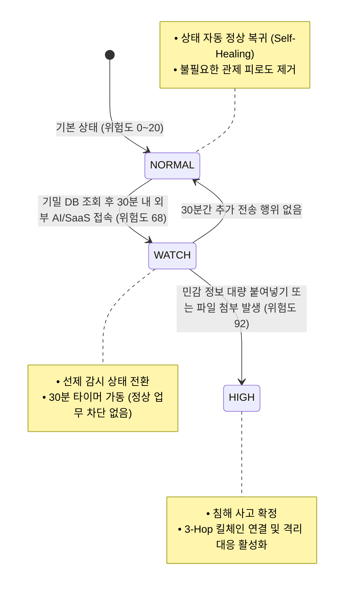
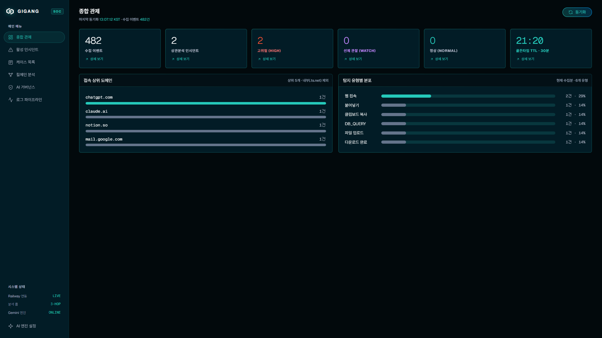
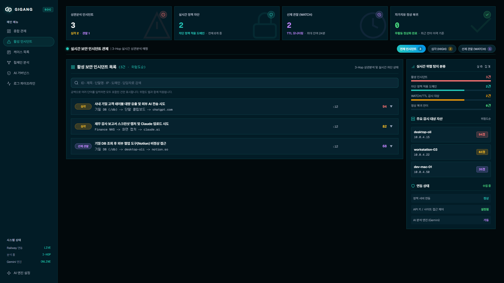
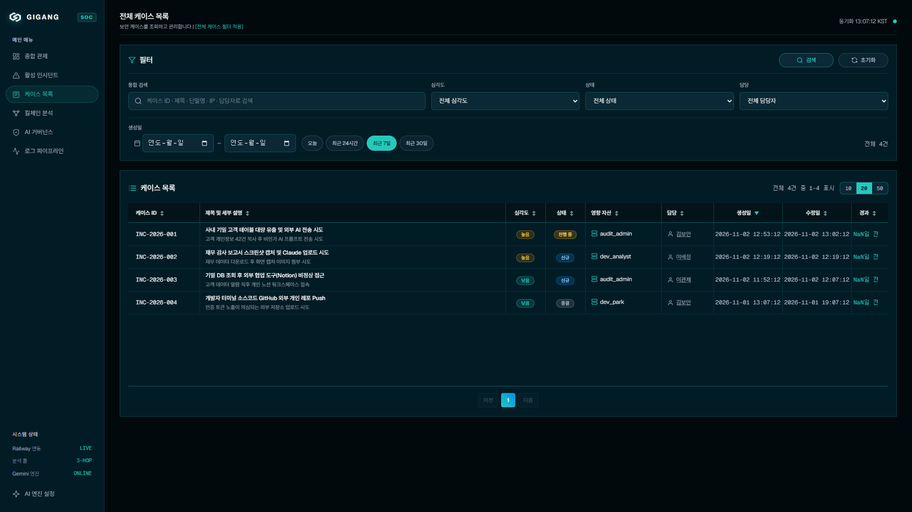
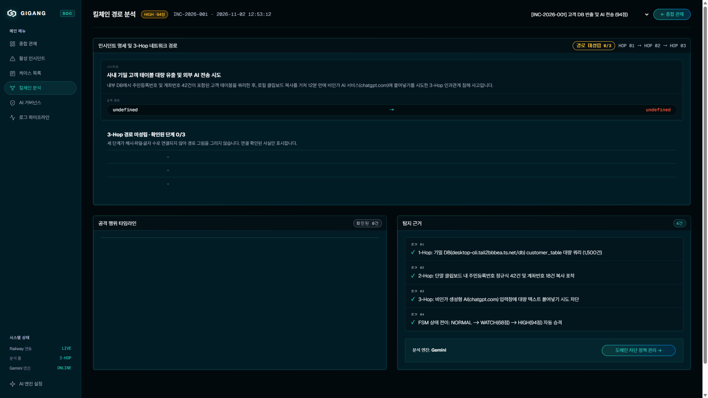
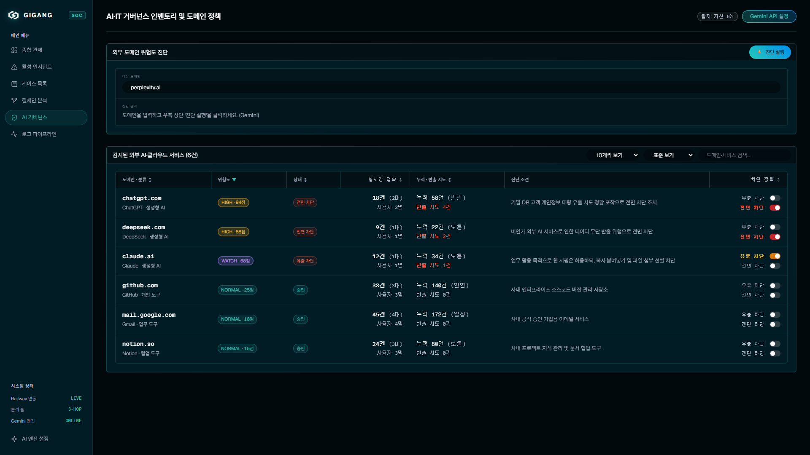
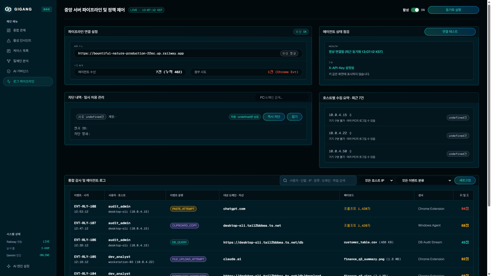

# GIGANG

> 엔드포인트-DB-웹 상관분석 및 Shadow AI 거버넌스 관제 시스템 (v4.0 Enterprise)

[](LICENSE)
[](https://www.python.org/)
[](guard/browser_extension)
[](guard/agent)
[](tests)

GIGANG은 사내 기밀 DB 접근, 사용자 단말 행위(클립보드 복사, 화면 캡처, OCR, 파일 조작), 브라우저 외부 전송의 상관관계를 분석하여 내부 정보 유출을 탐지하고 제어하는 보안 관제 플랫폼입니다.

---

## 1. 핵심 아키텍처 및 기능

### 3-Hop 인과관계 킬체인 분석
기밀 DB 접근에서 외부 유출까지의 흐름을 3단계 인과관계로 연결하여 추적합니다.
- **1-Hop (DB 접근)**: 사내 기밀 DB 조회 및 대량 다운로드 이벤트 감지
- **2-Hop (단말 행위)**: 텍스트 복사, 화면 캡처, 로컬 파일 생성 등 유출 준비 행위 추적
- **3-Hop (외부 유출)**: 비인가 AI 서비스나 외부 SaaS로의 붙여넣기, 파일 첨부 시도 포착

### FSM 기반 3단계 동적 라이프사이클
유한 상태 머신(FSM)을 통해 단순 오탐 알람을 최소화하고 실제 유출 시점에 집중 대응합니다.



### 선별적 차단 정책 (전면 차단 vs 유출 차단)
단순한 전체 사이트 차단(All-or-Nothing)을 탈피하여 업무 영향도를 최소화하는 상호 배타 2단계 정책을 제공합니다.
- **전면 차단 (Full Block)**: 도메인 접속 자체를 원천 차단 (`hosts` DNS 0.0.0.0 매핑 + 브라우저 차단 페이지 안내).
- **유출 차단 (Leak Block)**: 정상 업무를 위한 사이트 웹 서핑은 허용하되, 복사·붙여넣기 및 파일 업로드/드롭 이벤트만 브라우저 단에서 차단.
- **중앙 폴백 동기화**: 로컬 단말 에이전트가 꺼져 있어도 브라우저 확장이 Railway 중앙 정책 서버에서 직접 정책을 동기화하여 공백 없는 차단을 보장합니다.

### 무수집 원칙 (Zero Payload Ingestion)
개인정보 및 업무 기밀 유출을 방지하기 위해 단말에서 텍스트 본문이나 원본 파일 데이터를 수집하지 않습니다.
- 텍스트 길이, 바이트 수, 민감 패턴(주민등록번호, 계좌번호, 카드번호 등) 일치 건수, 파일 해시, 접속 도메인 메타데이터만 수집·분석합니다.

### Image Guard & 로컬 OCR
캡처 이미지나 그래픽 데이터를 브라우저에 업로드하려는 시도가 발생하면, 단말 로컬 OCR을 실행해 민감 정보 패턴 일치 건수만 집계하여 시각적 우회 유출을 방지합니다.

---

## 2. 관제 콘솔 인터페이스 (Cyber OS Terminal)

전술 관제 업무에 최적화된 풀스크린 단일 인터페이스를 제공합니다.



### 화면 구성 (6개 핵심 뷰)
| 1. 종합 관제 (Overview) | 2. 활성 인시던트 (Active Incidents) |
|---|---|
|  |  |

| 3. 전체 케이스 목록 (Cases) | 4. 3-Hop 킬체인 분석 (Kill Chain) |
|---|---|
|  |  |

| 5. Shadow AI 거버넌스 (Governance) | 6. 멀티소스 로그 파이프라인 (Pipeline) |
|---|---|
|  |  |

---

## 3. 시스템 구성도

```mermaid
flowchart TB
    subgraph Tier1["1. 분산 수집 센서 (Distributed Sensors)"]
        A["Chrome Extension<br/>(D&D 감지 / 텍스트 입력 통제 / 전면·유출 차단)"]
        B["Windows Agent<br/>(클립보드 감지 / Image OCR / hosts 파일 차단)"]
        C["DB Audit Stream<br/>(사내 DB 감사 로그 스트림)"]
    end

    subgraph Tier2["2. 인제스천 & 상관분석 엔진 (Ingestion & Correlation)"]
        D["Railway Central Server<br/>(PostgreSQL 중앙 정책 및 텔레메트리 릴레이)"]
        E["GIGANG Correlation Engine<br/>(FSM 기반 위험도 산출 및 3-Hop 킬체인 형성)"]
        F["Gemini AI Governance Engine<br/>(미승인 AI 도메인 자동 위험 진단)"]
    end

    subgraph Tier3["3. 전술 관제 콘솔 (Operations Terminal)"]
        G["Cyber OS 관제 콘솔<br/>(Streamlit 기반 실시간 인터랙티브 대시보드)"]
    end

    A <-->|로컬 통신 (8765) & 중앙 폴백| D
    B -->|이벤트 전송 & 정책 수신| D
    C -->|감사 로그 전송| D
    D -->|로그 스트림| E
    E <--> F
    E --> G
    G -->|정책 변경 API 요청| D
```

---

## 4. 디렉토리 구조

```text
GIGANG/
├── app.py                             # 메인 대시보드 진입점
├── run_agent.bat                      # Windows 관리자 권한 에이전트 런처
├── run-dashboard.bat                  # 관제 대시보드 실행 배치 파일
├── run_beta_terminal.bat              # Cyber OS 단독 터미널 실행 스크립트
├── RUN_ALL_TESTS.bat                  # 전체 단위 테스트 일괄 실행 스크립트
├── gigang_terminal.html               # 독립 실행형 전술 관제 터미널 UI
├── requirements.txt                   # 파이썬 의존성 목록
│
├── guard/                             # 단말 엔드포인트 보안 시스템
│   ├── agent/                         # Windows 에이전트 (클립보드 감시, OCR, hosts 차단)
│   └── browser_extension/             # Chrome 확장 프로그램 (입력 가드, 유출 차단, 동기화)
│
├── gigang/                            # 백엔드 분석 및 관제 패키지
│   ├── collectors/                    # 로그 수집 및 Railway 연동 모듈
│   ├── engine/                        # FSM 상관분석 엔진 및 거버넌스 진단 모듈
│   ├── schemas/                       # 표준 보안 이벤트 스키마
│   ├── storage/                       # 인메모리 스토어 및 SQLite 캐시
│   └── ui/                            # 대시보드 브릿지 및 UI 컴포넌트
│
├── source/railway_server/             # 중앙 인제스천 서버 (Flask + PostgreSQL)
│   ├── app.py                         # 중앙 정책 및 텔레메트리 엔드포인트
│   ├── policy_tables.sql              # 중앙 DB 스키마 DDL
│   └── site_access.py                 # 사이트 일시 허용 관리 모듈
│
└── tests/                             # 단위 및 통합 테스트 스위트 (84개 테스트)
```

---

## 5. 실행 가이드

### 1. 환경 준비
- **Python 3.10 이상**
- Google Chrome 브라우저
- Google Gemini API Key (선택 사항: 미설정 시 내장 룰베이스 엔진으로 자동 폴백)

### 2. 저장소 복제 및 패키지 설치
```bash
git clone https://github.com/dldaudlee36/GIGANG.git
cd GIGANG

pip install -r requirements.txt
```

### 3. 환경 변수 설정 (선택 사항)
Gemini AI 진단 기능을 활성화하려면 루트 경로에 `.env` 파일을 생성합니다:
```bash
GEMINI_API_KEY=your_gemini_api_key_here
```

### 4. 관제 대시보드 실행
```bash
run-dashboard.bat
# 또는
python -m streamlit run app.py
```
브라우저에서 `http://localhost:8501`로 접속하면 관제 콘솔이 바로 열립니다.

### 5. 단말 에이전트 실행 (관리자 권한)
단말 차단 및 클립보드 감시를 위해 에이전트를 구동합니다:
- 루트의 **`run_agent.bat`** 파일을 더블 클릭하여 실행합니다 (관리자 권한 자동 승격).

### 6. Chrome 확장 프로그램 설치
1. Chrome 주소창에 `chrome://extensions` 입력 후 엔터.
2. 우측 상단의 **'개발자 모드'** 활성화.
3. **'압축해제된 확장 프로그램을 로드합니다'** 클릭 후 저장소의 `guard/browser_extension` 폴더 선택.

### 7. 테스트 스위트 실행
```bash
# 전체 테스트 실행 (84개 항목)
python -m pytest tests/
# 또는
RUN_ALL_TESTS.bat
```

---

## 6. 데이터 연동 규격

- **실측 데이터 모드**: 대시보드는 임의의 목업 데이터를 생성하지 않으며, 실제 수집된 데이터가 없을 경우 '데이터 없음' 상태를 유지합니다.
- **데이터 출처**: Railway 서버(`RAILWAY_URL`) 및 로컬 텔레메트리 로그.
- **정책 지속성 (Local-First)**: 관리자 콘솔에서 설정한 도메인 정책은 로컬 `runtime/blocked_domains.json`에 즉시 기록되며, Railway 중앙 서버로 비동기 동기화됩니다.
