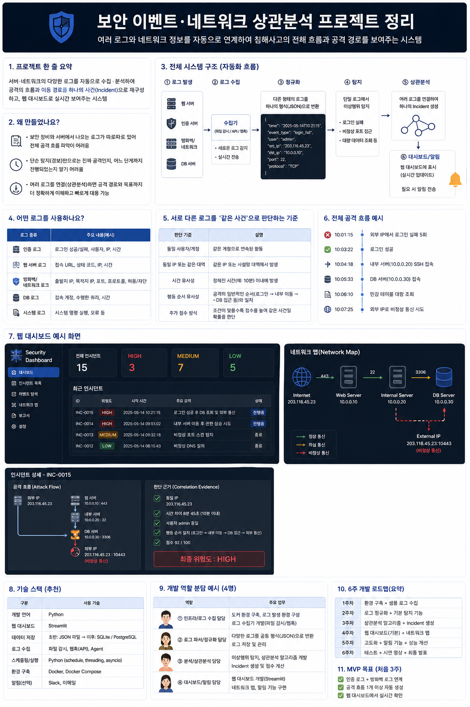
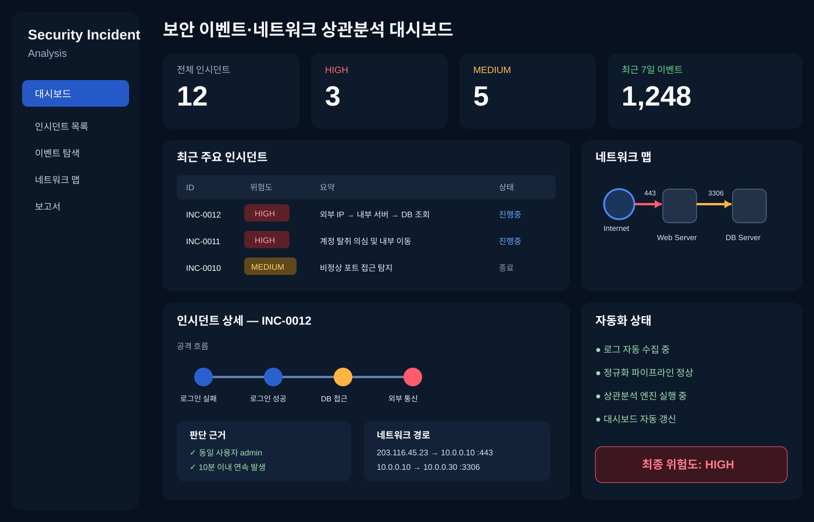
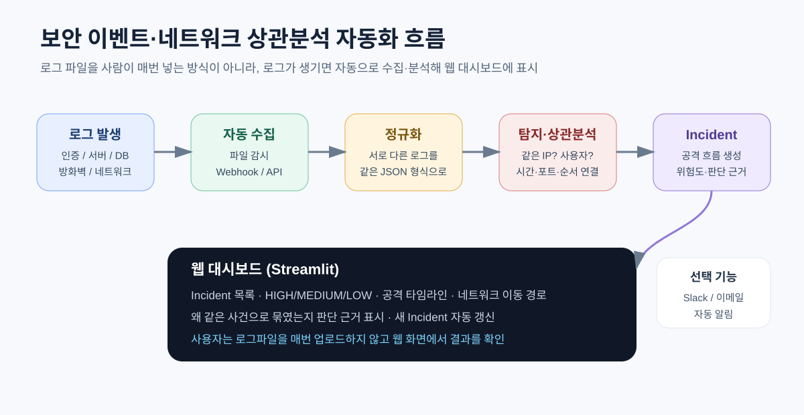
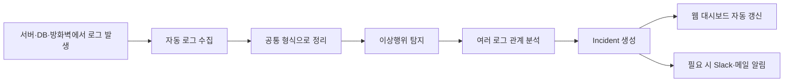
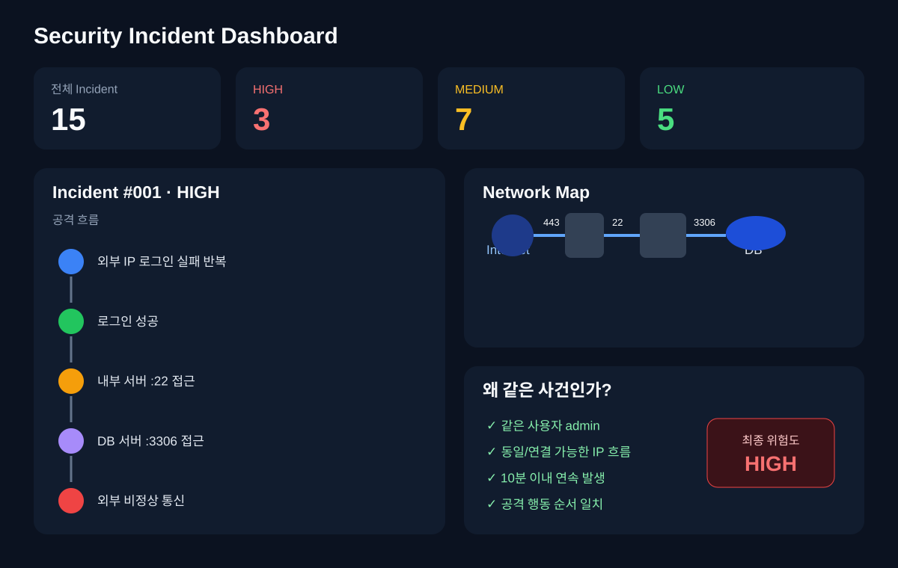
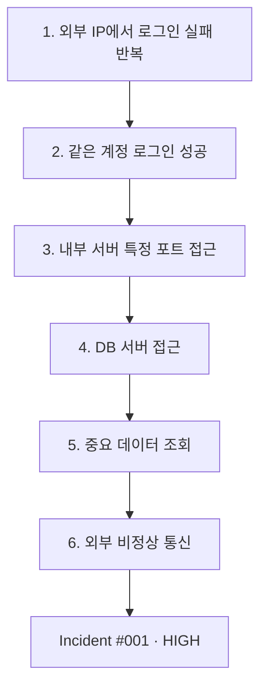
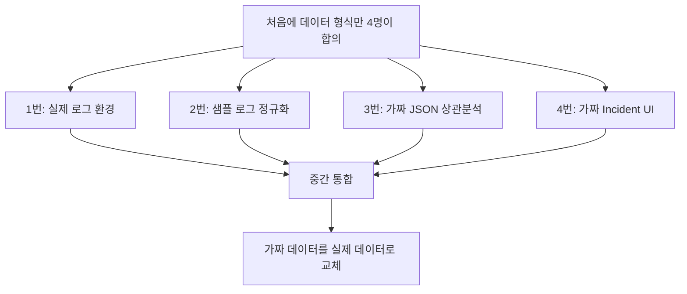

# 보안 이벤트·네트워크 상관분석 프로젝트 — 쉬운 기획서 v0.4



## 🎨 화면 시안

아래 화면은 실제 구현 시 목표로 하는 웹 대시보드 예시다. **로그 자동 수집 → 상관분석 → Incident 생성 → 네트워크 경로 표시 → 대시보드 자동 갱신** 흐름을 한 화면에서 확인하는 형태로 구성한다.



> 처음부터 이 화면을 완성하는 것이 아니라, 1주차에는 Mock 데이터로 화면을 먼저 만들고 이후 실제 로그 분석 결과로 하나씩 교체한다.
> 

---

<aside>
🛡️

**한 줄로 말하면:** 서버·DB·방화벽 등에서 로그가 생기면 프로그램이 자동으로 가져와 분석하고, 서로 관련된 행동을 하나의 공격 사건으로 묶어 웹 대시보드에 보여주는 프로젝트다.

</aside>

## 1. 우리가 만들려는 것 — 그림으로 먼저 보기



### 사람이 직접 로그파일을 넣는 프로그램이 아니다

최종 목표는 아래처럼 **자동으로 계속 돌아가는 관제 시스템**이다.



<aside>
💡

**사용자가 하는 일:** 마지막에는 로그파일을 매번 업로드하는 게 아니라, 웹 대시보드를 열어 새로 발생한 Incident와 공격 흐름을 확인한다.

</aside>

## 2. 왜 이 프로젝트를 만드는가?

보안 사고의 흔적은 한 곳에만 남지 않는다.

| 로그 종류 | 여기서 볼 수 있는 것 | 예시 |
| --- | --- | --- |
| 인증 로그 | 누가 로그인했는지 | 로그인 실패, 로그인 성공 |
| 서버 로그 | 어떤 기능·페이지에 접근했는지 | 관리자 기능 접근 |
| DB 로그 | 어떤 데이터를 조회했는지 | 중요 테이블 대량 조회 |
| 방화벽·네트워크 로그 | 어디서 어디로 통신했는지 | 출발지 IP, 목적지 IP, 포트 |

각각 따로 보면 단순 행동처럼 보일 수 있다. 하지만 연결하면 다음처럼 **하나의 공격 흐름**이 보일 수 있다.


## 3. 프로젝트 한 줄 정의

> **여러 시스템의 보안 로그와 네트워크 통신 정보를 자동으로 수집·분석하고, 관련 이벤트를 하나의 침해사고와 공격 이동 경로로 재구성하는 시스템**
> 

## 4. 실제로 어떻게 실행되는가?

### 개발할 때

처음에는 `sample_auth.log`, `sample_firewall.log` 같은 테스트 파일이나 가짜 데이터를 사용한다.

### 최종 버전

프로그램을 실행해두면 로그가 새로 생길 때 자동으로 가져온다.

| 방법 | 쉽게 말하면 | 어디에 사용? |
| --- | --- | --- |
| 파일 감시 | 로그파일에 새 줄이 생겼는지 계속 확인 | 서버 로그, 인증 로그 등 |
| Webhook / API | 이벤트가 생기면 분석 서버로 바로 전송 | 직접 만든 서비스·수집기 |
| 주기적 확인 | 몇 초마다 새 데이터가 있는지 확인 | 초기 구현에서 단순하게 사용 |

```
로그 발생
   ↓ 자동
로그 수집
   ↓ 자동
정규화
   ↓ 자동
탐지
   ↓ 자동
상관분석
   ↓ 자동
Incident 생성
   ↓ 자동
웹 화면 갱신
```

## 5. 우리가 웹에서 보게 될 화면



웹페이지에서는 최소한 다음을 보여준다.

| 화면 | 무엇을 보여주나? |
| --- | --- |
| 대시보드 | 전체 Incident 수, HIGH / MEDIUM / LOW 개수 |
| Incident 목록 | 최근 발생한 사건과 위험도 |
| 공격 타임라인 | 로그인 → 내부 접근 → DB 접근 → 외부 통신 순서 |
| 네트워크 맵 | 공격자가 어떤 서버와 포트를 거쳐 이동했는지 |
| 판단 근거 | 왜 여러 로그를 같은 사건으로 묶었는지 |

## 6. 프로젝트의 핵심 — 서로 다른 로그를 어떻게 같은 사건이라고 판단하나?

단순히 로그를 한 파일에 모으는 것이 핵심이 아니다. **로그 사이의 관계를 판단하는 규칙**이 가장 중요하다.

| 판단 기준 | 쉽게 설명하면 | 초기 예시 점수 |
| --- | --- | --- |
| 같은 사용자 | 같은 계정에서 이어진 행동인가? | +2 |
| 같은 IP | 같은 출발지에서 발생했나? | +2 |
| 시간이 가까움 | 예: 10분 안에 연속으로 발생했나? | +2 |
| 네트워크 경로 연결 | 앞 이벤트의 목적지가 다음 이벤트의 출발지와 이어지나? | +2 |
| 행동 순서 일치 | 로그인 → 내부 접근 → DB 접근처럼 공격 흐름이 자연스러운가? | +4 |

> 점수는 아직 확정값이 아니다. 실제 테스트를 하면서 잘못 묶이는 경우를 확인하고 수정한다.
> 

## 7. 첫 번째로 만들 공격 시나리오

처음부터 여러 공격을 넣지 않는다. 아래 **1개를 완성하는 것**이 먼저다.



### 예상 결과 예시

```
Incident #001
위험도: HIGH
사용자: admin

203.x.x.x
   ↓ 443
Web Server
   ↓ 22
Internal Server
   ↓ 3306
DB Server
   ↓
외부 비정상 통신

판단 이유
✓ 같은 사용자
✓ 연결되는 IP 흐름
✓ 10분 이내 발생
✓ 공격 행동 순서 일치
```

## 8. 로그를 같은 모양으로 바꾸는 이유

서버 로그와 방화벽 로그는 생김새가 다르기 때문에 먼저 **공통 JSON 형식**으로 바꾼다.

```json
{
  "timestamp": "2026-08-31T10:01:00",
  "source": "firewall",
  "user": "admin",
  "src_ip": "203.0.113.10",
  "dst_ip": "10.0.0.20",
  "dst_port": 22,
  "protocol": "TCP",
  "event": "connection_allowed"
}
```

쉽게 말하면:

```
제각각 생긴 로그들
        ↓
모두 같은 양식으로 번역
        ↓
서로 비교하기 쉬워짐
```

## 9. 4명 역할 분담 — 모두 동시에 시작

| 담당 | 주요 업무 | 아주 쉽게 말하면 | 첫날부터 할 수 있는 일 |
| --- | --- | --- | --- |
| ① 인프라·로그 수집 | Docker, 서버·DB 환경, 실제 로그 생성·수집 | 로그가 생기고 들어오는 길 만들기 | 테스트 서버 구성, 샘플 로그 준비 |
| ② 로그 파싱·정규화 | 여러 로그를 공통 JSON으로 변환 | 제각각인 로그를 같은 모양으로 정리 | 가짜 로그로 변환 코드 작성 |
| ③ 탐지·상관분석 | 이상행위 탐지, Incident 관계 판단 | 어떤 행동들이 같은 공격인지 판단 | 가짜 JSON으로 점수·규칙 구현 |
| ④ 웹 대시보드 | Streamlit 화면, Incident·네트워크 맵 표시 | 결과를 눈에 보이게 만들기 | 가짜 Incident로 화면 제작 |

1번 4번 2번 3번 순으로 쉬울 듯 → 요 부분은 무시하세요 새로

### 왜 한 사람 작업이 끝날 때까지 기다리지 않아도 되나?



## 10. 어떤 기술로 만들까? — 어렵지 않게 시작

| 부분 | 추천 기술 | 이유 |
| --- | --- | --- |
| 분석 코드 | Python | 로그 처리와 탐지 구현이 쉽고 교육 내용과 연결됨 |
| 웹 화면 | Streamlit | HTML/CSS를 깊게 몰라도 Python으로 웹 대시보드 구현 가능 |
| 초기 데이터 저장 | JSON / SQLite | 설정이 간단함 |
| 최종 DB | SQLite 또는 PostgreSQL | Incident와 이벤트 저장 |
| 환경 구축 | Docker / Docker Compose | 서버·DB 환경을 팀원끼리 비슷하게 맞추기 쉬움 |
| 자동 수집 | Python 파일 감시 / Webhook / API | 사람이 로그파일을 직접 업로드하지 않게 함 |
| 알림 | Slack / 이메일 | HIGH Incident가 생겼을 때 선택적으로 알림 |

### 실행 예시

```
1. Docker 환경 실행
2. 로그 수집·분석 Python 프로그램 실행
3. Streamlit 실행
   streamlit run app.py
4. 브라우저에서 대시보드 확인
   http://localhost:8501
```

## 11. 6주 로드맵 — 쉬운 버전

| 주차 | 목표 | 눈에 보여야 하는 결과 |
| --- | --- | --- |
| 1주차 | 기획 + Mock 데이터 + UI 초안 | 가짜 Incident가 웹 화면에 뜸 |
| 2주차 | 로그 자동 수집 + 정규화 | 새 로그가 JSON으로 자동 변환됨 |
| 3주차 | 탐지 + 첫 상관분석 | 인증+네트워크 로그로 Incident 1개 생성 |
| 4주차 | 관계 판단 알고리즘 개선 | 왜 같은 사건인지 근거 표시 |
| 5주차 | DB·서버 로그 추가 + 네트워크 맵 | 전체 공격 경로가 화면에 표시 |
| 6주차 | 통합 테스트 + 알림 + 발표 준비 | 공격 시나리오를 실행하면 웹 화면이 자동 갱신 |

## 12. 첫 번째 MVP 목표

<aside>
🎯

**처음 3주 안에:** 인증 로그 + 방화벽/네트워크 로그를 자동 수집하고, 관련 이벤트를 Incident 하나로 묶어 Streamlit 웹 화면에 자동으로 표시한다.

</aside>

MVP가 끝난 뒤에 DB 로그, 서버 로그, 네트워크 이동 경로, Slack 알림 등을 하나씩 추가한다.

## 13. 우리가 처음부터 하지 않을 것

- 거대한 SIEM 전체를 만들려고 하지 않는다.
- 공격 종류를 처음부터 10개씩 넣지 않는다.
- React·FastAPI·PostgreSQL·ELK 등을 첫날부터 전부 사용하지 않는다.
- 로그파일을 사람이 매번 업로드하는 형태를 최종 결과로 삼지 않는다.

**먼저 하나의 공격 시나리오가 `로그 발생 → 자동 수집 → 분석 → Incident → 웹 화면`까지 끝까지 흐르게 만드는 것이 가장 중요하다.**

## 13. 왜 이 프로젝트를 선택했는가

### 이런 프로그램이 원래 없는 건가?

아니다. SIEM·XDR 같은 상용 보안 솔루션에도 여러 이벤트를 연결해 하나의 Incident로 묶는 **이벤트 상관분석** 기능이 있다.

우리 프로젝트의 목표는 완전히 새로운 기술을 발명하는 것이 아니라, **실제 보안 현장에서 사용하는 개념을 교육생 수준에서 직접 설계하고 구현해보는 것**이다.

| 질문 | 답 |
| --- | --- |
| 이미 있는 기술 아닌가? | 맞다. 실제 SIEM/XDR에도 존재한다. |
| 그런데 왜 직접 만드나? | 서로 다른 로그가 어떤 기준으로 하나의 사건으로 연결되는지 직접 이해하고 구현하기 위해서다. |
| 우리만의 포인트는? | 단순 경보 생성보다, 시간·사용자·IP·네트워크 경로·행동 순서를 근거로 사건을 묶고 그 이유까지 보여주는 데 초점을 둔다. |

### 구현하기 어려운 부분은 어디인가?

화면을 띄우거나 로그 하나를 탐지하는 것보다, **서로 다른 로그를 왜 같은 사건으로 판단할지 정하는 부분**이 가장 어렵고 중요하다.

예를 들어 다음을 정해야 한다.

- 몇 분 안에 발생한 로그까지 같은 사건으로 볼 것인가?
- 같은 사용자지만 IP가 달라지면 어떻게 볼 것인가?
- 이전 목적지 IP와 다음 출발지 IP가 이어지면 같은 공격 경로로 볼 것인가?
- 조건이 일부만 맞을 때는 점수를 어떻게 줄 것인가?
- 서로 관계없는 로그를 잘못 하나로 묶는 경우를 어떻게 줄일 것인가?

<aside>
💡

**즉, 프로젝트의 진짜 핵심 난이도는 ‘탐지’보다 ‘관계 판단’에 있다.**

</aside>

### 면접에서 “왜 이걸 만들었나요?”라고 물으면

> **개별 로그만 보는 것보다 여러 시스템에 흩어진 흔적을 연결해서 공격 전체 흐름을 파악하는 과정이 실제 보안관제에 더 가깝다고 생각했습니다. 그래서 인증·서버·DB·네트워크 로그를 직접 정규화하고, 시간·사용자·IP·통신 경로를 기준으로 하나의 Incident로 묶는 과정을 구현해보고자 선택했습니다.**
> 

더 짧게 말하면:

> **실제 보안 솔루션에서도 사용하는 이벤트 상관분석을 직접 구현해보면서, 단순 탐지가 아니라 공격의 전체 흐름을 이해하는 과정을 경험해보고 싶어서 선택했습니다.**
> 

### “이런 거 이미 있지 않나요?”라고 물으면

> **네, SIEM이나 XDR 같은 상용 보안 솔루션에도 이벤트 상관분석 기능이 있습니다. 저희는 그 기능을 그대로 따라 만드는 것보다, 서로 다른 로그가 어떤 기준으로 하나의 사건으로 연결되는지 직접 설계하고 구현해보는 데 목적을 두었습니다.**
> 

### 우리가 설명할 때 가장 중요한 한 문장

<aside>
🎯

**완전히 새로운 보안 제품을 만드는 것이 아니라, 실제 보안관제에서 사용하는 이벤트 상관분석 과정을 직접 설계하고 구현하며 ‘왜 같은 사건인지’까지 설명할 수 있는 시스템을 만드는 프로젝트다.**

</aside>